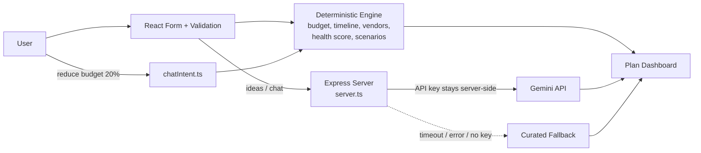

# 🎉 Celebration & Event Planner

A GenAI-powered planning assistant that helps people organize **weddings, birthdays and community events** with budgets, timelines, vendor checklists and personalized ideas.

Built for **PromptWars Virtual** (Hack2skill x Google for Developers).

> Live demo: `<add deployed link>`  |  Demo video: `<add video link>`

---

## 1. Chosen Vertical & Problem Solved

**Vertical:** Celebration & Event Planner.

Planning an event means juggling a budget, dozens of vendors, tight deadlines and endless ideas. Most people either overspend, book vendors too late, or lose track of tasks. This app turns a few inputs (event type, budget, guests, date, venue, priorities) into a complete, realistic plan and lets the user refine it by chatting.

## 2. Approach & Logic

The key design decision: **numbers are deterministic code, creativity is AI.**

| Concern | Handled by | Why |
|---|---|---|
| Budget split, per-guest cost, contingency | Code (`budget.ts`) | LLMs are unreliable at arithmetic; totals must match exactly |
| Timeline, rush plan, day-of schedule | Code (`timeline.ts`) | Date math must be correct and testable |
| Vendor lead times, overdue flags | Code (`vendors.ts`) | Rules based on the event date |
| Plan Health Score (0-100) | Code (`healthScore.ts`) | Explainable, reproducible scoring |
| Chat commands like "reduce budget 20%" | Code (`chatIntent.ts`) first | Parsed deterministically, then plan is recomputed |
| Theme ideas, activities, menu, chat wording | Gemini (`gemini.ts`) | Where generative AI adds real value |
| No key / timeout / API failure | Curated fallback (`fallback.ts`) | App never crashes and works offline |

Context-based decisions include: guest count and venue type (indoor / outdoor / home) shifting the budget split, user priorities (food, decor, photography...) reallocating money, rush mode when the event is under 14 days away, overdue vendor flags when lead time has already passed, and per-guest cost warnings with suggested fixes.

## 3. How It Works



**Request flow**
1. User fills the form; input is validated and sanitized.
2. The deterministic engine builds the budget, timeline, vendor list, health score and scenarios instantly (no AI call).
3. Ideas are requested through the Express proxy, which calls Gemini with a timeout, one retry and an LRU cache. On any failure the curated fallback is used, and the UI labels the source as `ai` or `fallback`.
4. Chat messages are first checked for numeric intents (budget, guests, venue). If matched, the plan is recomputed in code; Gemini only helps with wording and ideas.

## 4. Features

- **Budget engine** with exact percentage splits per event type, guest/venue/priority adjustments, contingency reserve and rounding reconciliation
- **Timeline** counting backward from the event date, with **Rush Plan** mode, day-of schedule and post-event tasks
- **Vendor checklist** with priority, lead time, budget share, overdue flags and interview questions (progress saved in localStorage)
- **Plan Health Score** (0-100) with reasons and fixes
- **INR default** with INR / USD / EUR selector and Indian wedding function presets (Haldi, Mehendi, Sangeet, Wedding, Reception)
- **Spend tracker**: planned vs actual with an accessible over-budget alert
- **Calendar export** (`.ics`, RFC 5545-escaped)
- **Scenarios**: Lean / Standard / Premium comparison and a rain backup plan for outdoor venues
- **AI ideas and chat** powered by Gemini, with offline fallback
- **UI**: donut chart with data-table fallback, countdown, checklist progress ring, dark/light mode, font-size and high-contrast controls, print stylesheet for PDF export

## 5. Setup & Run

**Requirements:** Node.js 22.22+ (LTS) and npm.

```bash
git clone <repo-url>
cd <repo-folder>
npm ci
cp .env.example .env      # Windows: copy .env.example .env
```

Edit `.env`:

```
GEMINI_API_KEY=your_key_from_aistudio.google.com
GEMINI_MODEL=your_gemini_flash_model_name
```

Run in development:

```bash
npm run dev
```

Then open the URL shown in the terminal (typically `http://localhost:3000`).

Production build:

```bash
npm run build
npm start
```

> The app works without a key: it simply uses the curated fallback ideas.

## 6. Testing

All tests live in the separate `tests/` folder and run **offline** (Gemini is mocked, no network calls).

```bash
npm test            # run all tests
npm run coverage    # with coverage report
```

Test suites cover: budget splits (sum to 100, exact totals, edge cases), timeline math and rush plans, vendor overdue flags, input validation (negative, wrong type, XSS, bad dates), chat intent parsing, AI fallback behavior, health score, scenarios, spend tracker, `.ics` output, React components, and an end-to-end integration flow. GitHub Actions runs the suite on every push and pull request.

## 7. Security, Accessibility & Efficiency

**Security**
- API key is read from environment variables and used only on the server; `.env` is git-ignored
- Strict validation: types, ranges, enums, string lengths, real calendar dates
- User and AI text rendered via React text nodes only (no `dangerouslySetInnerHTML`)
- Content-Security-Policy, request throttling on AI calls, prompt-injection-resistant system prompt (user text is treated as data, topic restricted to event planning)
- Friendly errors with no stack traces; pinned dependencies

**Accessibility**
- Semantic landmarks, skip-to-content link, visible labels on every input
- Errors linked with `aria-describedby` and `role="alert"`; `aria-live` regions for results and chat
- Full keyboard operation with visible focus, WCAG AA contrast
- `prefers-reduced-motion` and `prefers-color-scheme` respected, rem units, table headers with `scope`, no color-only information
- Screen-reader summary and table fallback for charts

**Efficiency**
- Deterministic parts never call the AI
- LRU cache for identical AI requests, timeout and single retry, lazy client setup
- `useMemo` for computed plans; small bundle (about 108 kB gzipped JS)

## 8. Assumptions & Limitations

- Budget percentage splits and vendor lead times are reasonable industry-style defaults, not quotes from real vendors
- Currency conversion is display formatting only (via `Intl.NumberFormat`); amounts are not converted between currencies
- Dates are interpreted in the user's local time
- Plan data is stored in the browser (localStorage); there are no user accounts or database
- AI output is a suggestion and may vary; the numbers shown always come from the deterministic engine
- Rate limiting is in-memory and resets when the server restarts

## 9. Project Structure

```
src/
  main.tsx, App.tsx, config.ts, types.ts
  planner/       budget, timeline, vendors, validation, chatIntent,
                 healthScore, scenarios, spendTracker, ics
  ai/            gemini.ts (timeout, retry, cache), fallback.ts (offline ideas)
  components/    form, budget, timeline, vendor checklist, ideas, chat, etc.
  styles/        app.css
server.ts        Express proxy for Gemini (key stays server-side)
tests/           all unit, component and integration tests
.github/workflows/tests.yml
.env.example
```

## 10. Screenshots

<!-- Add 2-3 small screenshots here (under 1 MB total), e.g.

-->

## License

MIT